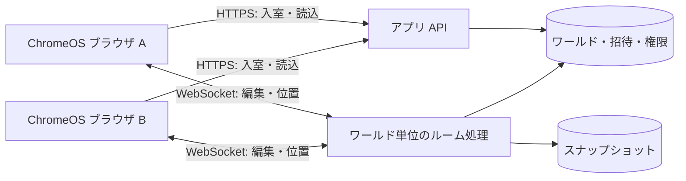

# システム設計（提案）

## 全体像

ブラウザはThree.jsで描画と入力を担当する。サーバーは参加権限の検証、ブロック操作の確定順序、自動保存、他の参加者への通知を担当する。DBとスナップショットはサーバー再起動後の復元に使う。プレイヤーの位置は一時情報として扱い、永続化しない。

## 技術方針

実装候補は TypeScript、Three.js、WebSocket、PostgreSQL。ルーム処理は同じワールドの操作を一つの順序で処理できる構成にする。具体的なホスティングは、WebSocketの継続接続、永続化、復旧、費用を検証してから決める。現行の静的Sites配信は試作版の配信に使えるが、それだけでは共有状態やリアルタイム同期を提供しない。既存コードの流用範囲とサーバーの移行先を検証する。

## 整合性と復旧

サーバーが各編集を認可・検証し、ワールドごとに単調増加する revision を付けて永続化後に確定通知する。同じ座標の競合はサーバー受信順で処理し、期待する元のブロックが変化していれば後続操作を拒否して最新状態を返す。クライアントは未確定の操作を明示し、拒否時は元に戻す。操作IDを使って再送時の重複を防ぐ。再接続時は最新スナップショットと、その後の確定イベントを取得する。保存が失敗した操作は確定通知しない。

スナップショットは一定時間または一定操作数ごとに作成し、日次の世代を保持する。復元は管理者のみ可能とし、復元前にも現在の状態を保存する。復元中は編集を停止し、全参加者に新しい状態を再読込させる。保持期間と容量上限は運用・費用検証で決定する。

## 認証・権限

大人は管理者として認証し、子どもは短時間有効な招待リンクから部屋限定セッションを取得する。管理者のみ招待の発行・無効化・復元を行える。サーバーは全HTTP・WebSocket操作で権限を検証し、期限切れや取り消しを反映する。セッションは安全なCookie等で管理し、招待トークンをログや分析に記録しない。リンク共有だけでは相手の本人確認はできない。

## 性能・操作

初期目標は同時4人、最大8人、有限ワールド。具体的な広さ、更新頻度、許容遅延は実機測定で確定する。表示範囲ごとのチャンク化と変更部分のみの再描画を導入し、現在の操作ごとに全ブロックを再構築する方式から移行する。位置更新は編集の確定とは別の一時メッセージとし、帯域・頻度を制限する。WebGL未対応・接続失敗・権限切れを分かりやすく表示する。
